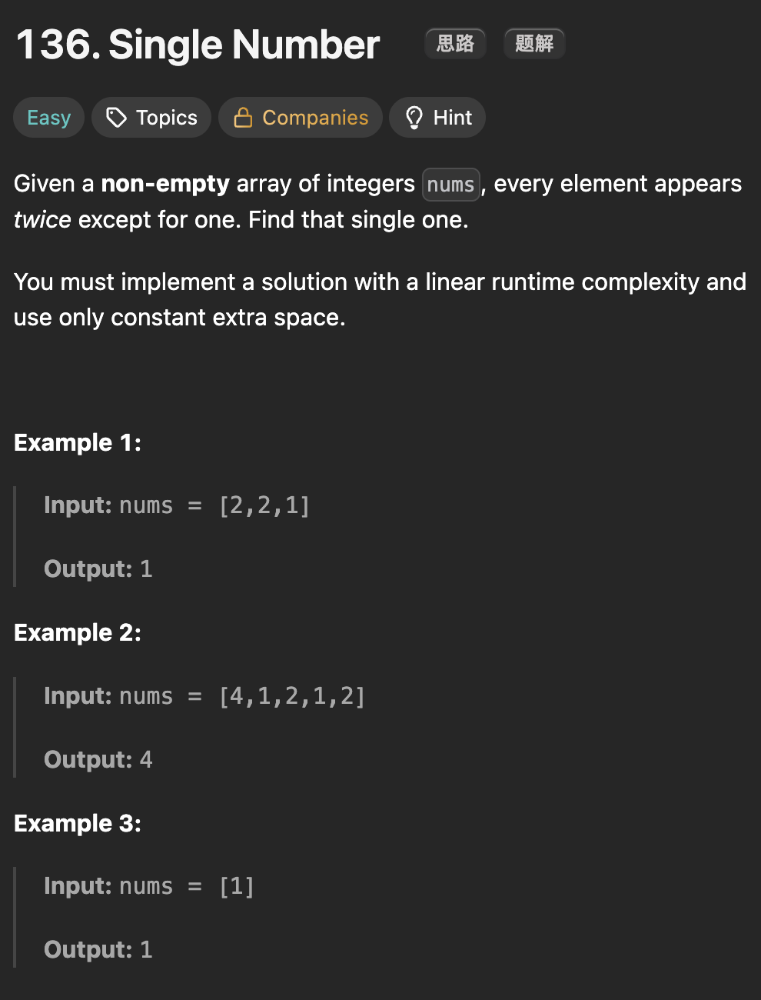

# LeetCode 136 - Single Number

**类型**：bit manipulation
**难度**：easy

---

## 一、题目描述（截图）



---

## 二、解题思路

1. 位运算XOR，每一位的数相同为0，不同为1，任何与0 XOR 的数保持不变

## 三、正确解法

```java
class Solution {
    public int singleNumber(int[] nums) {
        // n ^ 0 = n
        int res = 0;
        for (int num : nums) {
            res ^= num;
        }
        return res;
    }
}
```

---

## 四、容易踩坑点

- [ ]
